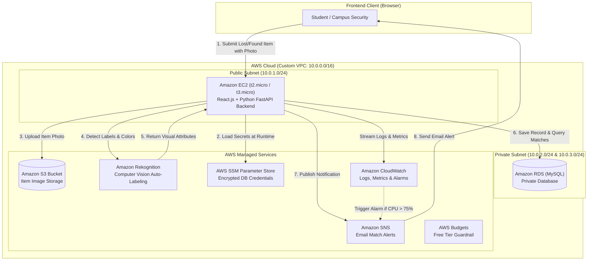

# Project Details: Campus Lost & Found with AI-Assisted Item Matching

This document contains the complete project proposal, technical stack, abstract, and condensed service justification formatted specifically for college submission sheets.

---

## 1. Quick Copy-Paste Submission Block (For Google Sheets / Approval Form)

### **Project Title**
Campus Lost & Found with AI-Assisted Item Matching

### **Technology Stack**
```text
Frontend: React.js, HTML5, CSS3, JavaScript
Backend: Python FastAPI
Database: MySQL (Amazon RDS)
Cloud: Amazon EC2, Amazon VPC, Amazon RDS, Amazon S3, Amazon Rekognition, AWS IAM, AWS Systems Manager Parameter Store, Amazon CloudWatch, Amazon SNS, AWS Budgets
```

### **Abstract**
```text
A cloud-based platform for managing lost and found items on campus, enabling students to report lost belongings, upload photos of recovered items, and receive automated match notifications instead of relying on manual bulletin boards or messaging groups. It includes intelligent item matching based on Rekognition-generated labels (category, color, distinguishing attributes), along with monitoring for system health during peak reporting periods (start/end of semester). The project supports SDG 11 (Sustainable Cities and Communities) by strengthening community-level campus services, and SDG 12 (Responsible Consumption and Production) by reducing item loss/waste and extending the useful life of personal belongings through faster recovery.
```

### **Justification for Services (Short Format for Table / Sheet)**
```text
EC2: Hosts frontend and backend API; Custom VPC: Provides isolated network infrastructure; Subnets & Route Tables: Organizes and isolates public compute and private database traffic; Internet Gateway: Provides controlled internet access for public-facing application; Security Groups: Restricts ingress/egress traffic between client, EC2, and RDS; RDS: Stores user accounts, lost/found item records, and label vectors; S3: Securely stores item photos and generated reports; Rekognition: Automatically detects item categories, colors, and visual labels for intelligent matching; IAM: Enforces least-privilege role-based access for EC2 without hardcoded keys; Parameter Store: Securely manages database credentials and JWT secrets; CloudWatch: Handles application logs, performance metrics, and triggers high-CPU alarms; SNS: Sends automated email match notifications to students; AWS Budgets: Tracks free-tier consumption and sends proactive cost alerts.
```

---

## 2. In-Depth Project Architecture



---

## 3. Detailed Component Breakdown

### 1. Frontend Tier (React.js)
- Responsive portal for students and campus security.
- Form to report lost items (date, location, category, description).
- Form to report found items with immediate image upload.
- Visual matching dashboard displaying potential matches with confidence percentages.
- Claim management and resolution workflow.

### 2. Backend Tier (Python FastAPI on EC2)
- Fast, asynchronous REST API.
- Endpoints for user authentication, item reporting, image processing, and search.
- Direct integration with AWS SDK (`boto3`) using EC2 IAM Role credentials.
- Matching algorithm combining keyword metadata with Rekognition visual tags (category, color, attributes).

### 3. Database Tier (Amazon RDS MySQL)
- Placed in private VPC subnets with no public IP address.
- Tables: `Users`, `LostItems`, `FoundItems`, `ItemLabels`, `Matches`, `Claims`.
- Security group allows port 3306 inbound traffic solely from the EC2 Security Group.

### 4. Storage & AI Pipeline (S3 + Rekognition)
- When a photo is uploaded, backend saves it directly to a secure S3 bucket.
- Rekognition `DetectLabels` analyzes the S3 image and extracts object tags, colors, and attributes with confidence scores.
- These labels are stored in RDS for automated indexing and similarity scoring against lost item reports.

### 5. Security & Configuration (IAM + SSM)
- **Zero hard-coded credentials**: Code never contains AWS Access Key IDs or Secret Access Keys.
- IAM Instance Profile grants EC2 permission to S3, Rekognition, SNS, and SSM.
- Database host, username, password, and JWT secret stored in SSM Parameter Store (`SecureString`).

### 6. Monitoring & Cost Control (CloudWatch + Budgets)
- Application logs piped to CloudWatch log group.
- CloudWatch Alarm on EC2 CPU utilization (>75%) or 5xx errors triggering an SNS alert.
- AWS Budget configured with a $0.01 threshold to ensure zero unexpected billing outside Free Tier.
